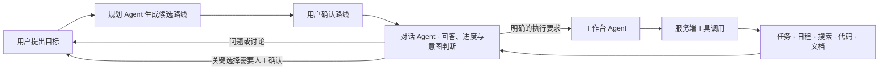

# VHFXNEX · 目标驱动的 AI 执行工作台

用户直接提出目标，Agent 给出首选与备选路线。用户确认后，Agent 调用任务、里程碑、具体日程、可行性核对、文档和预算工具，形成可继续推进的工作空间；除检查时段冲突外，还能核对已提供的人员排班、场地容量和共享物料总量，发现冲突后要求 Agent 修正。工具只校验明确提供的数据，不推断未知人手或库存。用户可以保存知识资料，Agent 在规划时检索相关片段，并展示所用来源。工作区所有者还可以发出限时邀请，赋予协作者编辑或只读权限；后台执行状态会同步显示给有权访问的成员。

在已有工作空间中，聊天先交给「对话 Agent」：它会回答一般问题和进度询问、继续讨论方向；只有判断为明确的实际工作时，才把保留上下文的完整指令交给「工作台 Agent」。工作台 Agent 负责调用项目工具、连续推进并交付文件。执行期间仍能问问题；新的工作要求会先保存到 SQLite 队列，当前轮结束后自动接手。`npm run dev` 和 `npm start` 会在会话密钥有效时同时启动持久队列 worker；页面关闭或切换工作区后任务仍可运行，刷新后也能恢复状态。数据库领取凭证和工作区执行锁避免重复执行。`/api/health` 检查 SQLite 与 worker 最近 20 秒内的心跳；启动脚本会监督网页和 worker，worker 意外退出时退出网页进程以触发部署重启。附件只在待执行期间暂存，交付、取消或权限撤销后即清除。实时模式下各 Agent 角色使用同一 DeepSeek 提供方，但拥有不同职责和工具权限；演示模式用本地规则模拟分流链路，不会声称调用模型。

聊天记录会标出「规划 Agent」「对话 Agent」或「工作台 Agent」的回复来源；工作台 Agent 的上下文只读取用户指示和工作台执行记录，避免对话答复被误当成待执行指令。三种角色共享同一工作区的目标、路线、进度和交付物。

执行工作区固定为左中右三栏，在常见桌面尺寸和 100% 缩放下不依赖整页滚动：左侧项目流程面板固定宽度，画布展示目标、阶段节点、连线与交付状态，可用鼠标拖动、滚轮或键盘平移，比例固定，不提供缩放或单独收起控件。全局导航栏贴着右边缘提供箭头，点击可隐藏；隐藏后屏幕左边缘保留展开箭头，导航状态会保存。中间主面板是连续对话，用户消息靠右，Agent 文本、实时状态、已完成工具调用与联网来源按顺序显示。快速/深度模式控制模型配置，界面展示可核对的执行摘要而不展示私有推理文本；右侧行动计划可用滚轮或键盘独立浏览路线、任务、时间线与模型用量。聊天输入区的工具箱会说明 Agent 可自动调用的搜索、规划、文件和代码能力，用户只需描述目标；演示模式与实时 AI 的能力边界会明确区分。生成成果默认收在聊天底部的紧凑入口中，展开后可以预览、编辑和下载。用户可附加图片、DOCX、PDF、Markdown、CSV/TSV、文本和代码文件作为本轮上下文；知识库可导入这些文档的可提取文本，单篇内容限制为 20000 字。

Agent 可生成可编辑的 Word `.docx`、中文排版 PDF `.pdf`、Markdown、Excel `.xlsx`、PowerPoint `.pptx`（含演讲备注）和可下载的代码项目 `.zip`，也支持日历 `.ics`。PDF 自动分页并嵌入 Noto Sans SC 字体子集；可继续编辑文档正文，再导出 PDF 或 Word。代码工具交付源码、依赖清单与运行说明；生成后先做语法、本地引用和清单静态校验，再由独立复核 Agent 检查入口与需求阻塞项。复核最多额外调用 DeepSeek 两次，其用量计入工作区；服务端不会执行生成代码。含 `index.html` 的网页项目还可在产物窗口中切换桌面与 390px 手机视口预览。预览禁用脚本、网络和外部跳转；交互运行需下载 ZIP 后在本地启动。网站不会代替用户部署生成的代码。所有工具只在实时 AI 模式下由模型按目标调用；演示模式使用本地样例，并明确标注未调用模型。

时间线可导出为 `.ics` 日历文件。计划中的“活动当天”“第 N 天”等相对日期会先要求用户指定开始日期，再按中国标准时间生成日历事件；日期不明确或时段无效时会说明原因，不会擅自补日期。



实时模式会调用 DeepSeek；演示模式使用清楚标记的固定样例和本地规则，不伪装模型调用。登录、账户恢复、知识库、管理员控制台与 SQLite 持久化用于完整的工作空间流程；管理员能力按角色校验。

## 本地运行

需要 Node.js 24+。运行 `npm install`，复制 `.env.example` 为 `.env.local`，填写 `DEEPSEEK_API_KEY` 和 `SESSION_SECRET`，再运行 `npm run dev`。打开 <http://localhost:3000>。所有 DeepSeek 请求都直接读取项目根目录的 `.env.local`；系统环境或 Codex 预览器继承的同名变量会被忽略。修改文件后，下一次请求立即读取新值，无需重启服务。

可选设置 `GOALFLOW_DATABASE_PATH` 更改 SQLite 文件位置；Web 服务、后台 worker 和备份/恢复命令共用同一解析规则。自定义路径应位于持久化目录中；默认位置为 `data/goalflow.sqlite`。备份命令默认写入 `backups/`，可用 `GOALFLOW_BACKUP_DIR` 自定义备份和恢复安全快照目录。

可用下面的 Node 命令生成至少 32 字节的随机会话密钥，再把输出粘贴到 `.env.local` 的 `SESSION_SECRET`：

```sh
node -e "console.log(require('node:crypto').randomBytes(32).toString('base64url'))"
```

`DEEPSEEK_API_KEY` 留空时，首页默认开启并明确标记演示模式；首页也可以手动切换。未配置 Key 时发起实时规划会显示配置提示，不会把演示数据伪装成模型结果。演示模式提供活动策划、日程安排、项目推进、旅行规划等固定样例，用于审阅交互流程；“新增一个任务：……”会通过本地规则模拟 `create_tasks`，不调用模型也不产生虚构用量，其他复杂补充会保存为备注。实时模式使用 DeepSeek V4.1 Flash；当前 API 模型 ID 是 `deepseek-flash`，支持文字目标、图片理解与工具调用。规划阶段可上传不超过 6 MB 的 JPG、PNG、GIF 或 WebP；执行阶段可在对话中附加一张图片，以及 DOCX、XLSX、PPTX、PDF、Markdown、CSV/TSV、文本或代码文件。DOCX 使用 Mammoth 提取文字，XLSX/PPTX 从工作簿单元格和幻灯片文字中提取上下文（压缩包不超过 5 MB、解压内容不超过 25 MB、分别最多 40 个工作表与 60 张幻灯片），PDF 使用同源打包的 PDF.js Worker 和标准字体资源；附件只作为本轮参考上下文，不保存到工作空间。可选语音输入先由浏览器 SpeechRecognition 转成文本，服务端只收到转写；视频输入由浏览器本地抽取最多 6 帧合成联系表，仅发送这些画面供视觉模型分析（视频上限 100 MB、10 分钟，不上传音轨）。

启动本地服务后运行 `npm run smoke`，可以无 API 消耗地端到端检查注册、恢复码找回与核销、改密、演示规划与执行、工作空间、知识库、权限边界和登出。配置了有效 DeepSeek Key 后，可运行 `npm run smoke:live` 检查真实规划、知识引用和 Agent 工具调用；`npm run smoke:vision` 单独发送一张本地色块图验证多模态识别，只触发一次实时规划请求。两项检查都会消耗 API 额度。所有检查都会创建临时本地账号并在结束时删除账号及关联数据，目标地址只允许本机回环地址。

`npm run smoke:search` 会发起真实 DeepSeek 工作台执行，并联网调用 DuckDuckGo，验证搜索工具选择、SSE 来源事件和工作区持久化；这会消耗真实 API 额度。`npm run smoke:ui:live-execute` 也会真实调用模型生成代码项目并消耗额度。没有启用实时测试选项时，其余常规 smoke 使用本地或模拟响应，不会调用 DeepSeek。只有在需要验证真实模型链路且接受相应费用时，才运行这些实时检查。

如果本地 BGE 模型已经缓存，可运行 `npm run smoke:knowledge` 离线检查中文语义向量和召回区分度；该命令禁用远程模型下载。模型未缓存时会跳过，不会为了测试自动下载。

`npm run smoke:telemetry` 使用内存 OTLP 测试导出器检查 Agent 与工具 span 的父子关系、错误状态和隐私属性过滤，不需要 DeepSeek Key 或外部收集器。

`npm run smoke:project` 离线检查代码项目交付：验证源码语法、JS/Vue 与 CSS/HTML 本地文件引用、源码导入及常见启动命令所需的 `package.json` 依赖声明和可运行入口，不会执行生成代码或调用模型。

如果实时规划返回 401，可运行管理员控制台里的“测试连接”。规划、执行和连接测试读取的是同一个 `.env.local` 值。不要把 Key 放入前端代码或提交到仓库。

安装本机 Chrome 后，可运行 `npm run smoke:ui` 检查真实浏览器流程：注册并保存恢复码、登录找回、账户资料与密码管理、账户数据备份、后台权限调整、演示规划与执行、左侧流程画布固定比例拖动查看、左侧导航从边缘收起/展开、右侧行动计划独立滚动、自动工具箱与模式说明、聊天最新回复与成果入口、成果展开及复制和下载、任务完成、完整工作区 Markdown 与 `.ics` 日历导出、邀请链接与只读权限、邀请页隐私和可访问性、编辑未保存确认、保存失败与会话过期恢复、工作空间删除，以及 320px 小屏和手机宽度下的认证、工作区项目阶段、账户设置、导航抽屉与管理表格。知识库流程覆盖 DOCX/XLSX/PPTX/PDF 导入、搜索、查看、编辑、保存失败保留草稿和删除；测试还会在注册、后台、路线选择、执行、共享对话框、邀请页、日历导出和知识库页面运行 axe-core 的 WCAG 2.2 AA 可访问性扫描。启用实时浏览器模式时还会模拟执行结果 SSE 中断，检查页面能否恢复服务器已保存的工作区。脚本仅访问本机回环地址，自动清理临时账号及数据；验收截图写入系统临时目录。若 Chrome 不在默认位置，设置 `PLAYWRIGHT_EXECUTABLE_PATH` 指向本地 Chrome/Chromium 可执行文件。可选设置 `NEXORA_TEST_AI_STATUS=1` 会额外触发一次管理员 AI 连接探测，消耗少量 API 额度。

浏览器烟测还会创建隔离的实时工作区，拦截 Agent 执行请求并核对浏览器提取出的 Markdown、XLSX、PPTX、PDF 与 `.env.example` 正文确实进入请求；该检查使用模拟 SSE 回执，不会调用真实模型。

如需让浏览器走 DeepSeek 实时规划（包括上传有效参考图和首次规划资料），可在 PowerShell 中运行 `$env:NEXORA_TEST_LIVE_UI = "1"` 后执行 `npm run smoke:ui`；该流程随后会模拟执行结果 SSE 中断来验证工作区恢复，真实 Agent 工具调用则由 `npm run smoke:live` 端到端检查。完成后运行 `Remove-Item Env:NEXORA_TEST_LIVE_UI` 清除标记。实时浏览器规划会消耗少量 API 额度。

首次在开发环境中注册的账号会成为管理员。生产环境请在注册前设置 `ADMIN_EMAIL`，并将 `SESSION_SECRET` 配置为至少 32 字节的随机值；短密钥会被拒绝，无法创建或验证登录会话。

## 评审演示路径

实时浏览器代码生成检查使用 `npm run smoke:ui:live-execute`，会真实调用 DeepSeek、产生 API 费用并下载 Agent 创建的网站源码 ZIP；结束后自动清理临时账号与工作区。

**离线演示约 3 分钟：**注册并保存一次性恢复码后，在首页切换到演示模式，输入：

> 规划一次校内 AI 分享会，预计 40 人，预算控制在 800 元以内，并安排一份 3 小时的现场议程表。

选择标有“AI 推荐”的路线并执行，查看任务清单、活动时段、预算草案和 Agent 工具记录。点击时间线的“导出日历”，选择活动开始日期，再把 `.ics` 文件导入常用日历应用。然后在补充指示框输入“新增一个任务：活动结束后收集参会反馈并整理复盘报告”，可看到新任务进入工作区；再试着完成任务、编辑或下载方案，并导出完整工作区 Markdown。演示结果由固定样例和本地规则生成，不调用模型；复杂指示只会保存为备注。

**实时 AI 演示：**在服务器 `.env.local` 配置有效 `DEEPSEEK_API_KEY` 后，切换到实时模式并重复同一目标。规划与工具结果来自 DeepSeek；目标页会显示实际模型用量，管理员控制台会汇总真实请求。可先在“我的知识库”保存活动规则，再规划目标，演示 Agent 检索资料并展示引用来源。录屏时不要展示 `.env.local` 或 API Key。

## 技术与结构

- Next.js App Router、React、TypeScript、自定义响应式 CSS、Motion、Lucide；左侧 ProjectFlowPanel 根据当前目标与实际任务展示领域阶段，聊天流展示实时状态、工具调用与来源，右侧独立呈现可滚动的行动计划。
- 执行 Agent 使用 Vercel AI SDK `streamText` 和官方 `@ai-sdk/deepseek` provider，支持 DeepSeek 多步工具调用、逐步取消与模型用量回报；执行状态、工具完成事件和最终工作区通过 SSE 实时送到页面。每轮对话会保存简明的阶段摘要和真实工具记录，便于回看并纳入完整工作区导出。
- Zod 4 为每个 Agent 工具定义参数结构和上下界。AI SDK 从同一份 schema 生成模型可用的工具定义，服务器在执行工具前校验参数，工具业务规则再检查预算和时间冲突。
- 规划接口保留服务端 DeepSeek Chat Completions 调用，以支持参考图片、知识检索和断线后按工作区 ID 恢复；Key 只在服务器读取，不进入浏览器。
- 首次规划支持参考图片和最多 6 份 DOCX、XLSX、PPTX、PDF、Markdown、TXT、CSV 或代码资料；服务端只使用文档摘录生成路线，不把摘录写入工作区。
- `POST /api/plan`：目标与图片理解、候选路线与结构化任务。实时规划结果由服务端在响应前持久化；浏览器连接中断时会按工作空间 ID 恢复，同一 ID 重试不会再调用一次模型；账号空间已满时会在模型调用前拒绝请求。
- `POST /api/chat`：流式对话 Agent。根据用户当前消息、历史对话、工作区成果与服务端保存的实际执行状态回答问题，或用结构化 `handoff_to_workbench` 工具交接执行要求；普通问题不会启动工作台。交接时，服务器在同一个 SQLite 事务中保存对话回复和完整工作要求（含附件），之后才把已保存的任务编号发给浏览器；页面断开不会留下“回复说已交接、队列里却没有任务”的状态。`POST /api/handoffs` 提供有上限的持久队列及原子领取、释放、完成和取消操作；登录后会恢复待执行队列。`POST /api/execute` 是交接后的工作台 Agent，继续使用多步工具循环和结果持久化。执行期间的新工作要求会在当前任务完成后排队执行。
- `POST /api/execute`：实时流式多步 Function Calling，服务端执行任务、项目里程碑、日程时段、文档和预算工具，并把进度与结果送到客户端；每一步只开放当前仍缺少的工具。如果模型没有补齐必需产物，会根据已有执行状态进行限步修复；没有完成时不会标成已交付，但每个成功工具的任务、文件、来源和事件都会先写回工作区，异常退出后已完成阶段成果仍可查看或继续推进。每个工作空间用数据库租约保证同一时间只有一轮实时执行，其他标签页不能以旧快照覆盖正在生成的结果；租约会随模型步骤续期。最终结果与累计用量在 SSE 完成事件发出前保存，用户主动停止会中止当前模型请求。
- OpenTelemetry 通过 Next.js instrumentation 接入服务端。规划请求、Agent 执行与修复轮次、单个工具调用会生成层级追踪；属性白名单只允许操作、模型/工具名、Token 数、状态和步骤计数，不记录目标文本、知识库正文、用户标识、图片或 API Key。可在 `.env.local` 设置 `OTEL_EXPORTER_OTLP_ENDPOINT`，将 traces 发送到任意兼容的 OTLP 收集器；未设置时应用仍可正常运行。
- `GET /api/workspaces/[id]`：只读取当前账户的单个工作空间，用于连接中断后的精准恢复。
- 实时工作区从规划、对话到工作台执行，记录 API 实际返回的输入/输出 Token、模型名、请求次数和耗时；管理员可按目标工作空间与 Agent 来源（规划、对话、工作台）查看用量。手动进行的 AI 连通性检查也纳入全局用量，单独列为连接诊断，不归入某个工作空间。旧记录若没有来源标签会单独标记，无法反向推断的请求不会混入新分类。缓存命中率只按接口明确提供缓存统计的输入样本计算；接口未返回缓存元数据时显示“暂无接口统计样本”，不会把缺失数据误报为 0% 命中。Token 数用于定位消耗来源，不等同人民币费用；实际金额以 DeepSeek 开放平台账单为准。演示模式与工作区导出明确不伪造用量。
- `GET/POST /api/knowledge` 与 `PUT/DELETE /api/knowledge/[id]`：用户私有知识资料；支持导入、搜索、查看、修改和删除，按段落切块，优先用本地缓存的中文 BGE 向量模型进行语义召回；模型不可用时回退到中英混合词元、TF 与 IDF 排序。首个语义检索请求可能需要联网下载量化模型，失败不会阻断关键词检索。
- `POST /api/workspaces/[id]/sharing` 与 `POST /api/workspace-invites/accept`：工作区所有者创建限时邀请，接受者成为编辑者或只读成员；可查看、移除成员和撤销邀请。共享进度对成员可见，编辑者可发起执行，只有所有者可管理分享。
- SQLite 保存用户与工作空间；密码先经 SHA-256 预处理再用 bcrypt 哈希，避免长 Unicode 密码被 bcrypt 的字节上限截断；旧哈希会在成功登录后升级。登录状态使用签名 HTTP-only Cookie，退出登录时会撤销旧会话令牌。登录、注册、密码恢复、恢复码操作以及实时 AI 规划与执行会按账号和请求来源限流：每个账号每 15 分钟规划与执行各 12 次、合计 20 次；每个请求来源每类 60 次、合计 120 次。演示模式不消耗 AI 调用额度。
- 账户设置展示当前身份与加入时间；用户可更新显示名称，也可验证当前密码后更新密码。改密后旧设备会话随即失效，当前设备自动续签。
- 工作空间保存遇到网络错误时保留页面结果并可重试，不重复调用模型；会话过期时，当前标签页暂存的工作空间或目标草稿只会在同一账户重新登录后恢复。未完成的规划不会自动再次提交，用户可检查输入后自行继续。
- 规划或执行时间较长时，用户可以手动停止；取消信号会传到服务端模型请求与 Agent 工具循环，本轮未返回的结果不会覆盖已有工作空间。
- 用户可导出并导入自己的账户 JSON 备份；导入会合并为新工作空间和知识资料，并重新映射关联 ID，不覆盖原数据，也不导入认证密钥或会话数据。
- 每个账号最多保存 100 个工作空间和 100 篇知识资料；每个工作空间按 UTF-8 字节数限制为 250 KB，以容纳可下载的代码项目。备份导入会先检查总量，超限时整批拒绝，不会留下部分导入的数据。账户备份文件上限为 20 MB，可覆盖各类数据的单账号存储上限。
- 管理控制台可查看用户、工作空间、执行概况、AI Token/请求耗时汇总、按项目与 Agent 来源拆分的用量和近 7 日趋势，调整其他用户的角色，删除用户时同步清理其资料、用量记录与工作空间，并删除不需要的工作空间。用量统计不保存提示词或 API Key。管理员可手动运行最小 AI 连通性检查；它不会自动调用或暴露 API Key。

界面用 React 状态管理当前页面的短期交互；TanStack Query v5 管理私有知识库请求、缓存、重试和乐观新增/删除，失败时回滚，登出或会话过期时清除私有缓存，账户备份导入后重新同步。ProjectFlowPanel 按任务阶段展示用户可执行的工作路径；Motion 提供状态过渡，界面采用自定义响应式 CSS。项目目前不依赖 Tailwind、shadcn/ui 或 Zustand：自定义界面已有独立的视觉系统，当前规模也不需要再引入一套全局状态层。

后端使用 Next.js Route Handlers、Vercel AI SDK 与官方 DeepSeek Provider；Zod 4 校验模型工具参数；SQLite 事务和索引保存账户、用量、知识资料与工作空间；JOSE 签名 HTTP-only 会话 Cookie，bcryptjs 处理密码哈希。Playwright 驱动浏览器烟测。这里优先选择能解决当前问题的技术：工具调用、流式响应、持久化、访问控制、缓存一致性和真实浏览器验收，而不是把推荐表中的库全部堆进依赖。

## 部署说明

单机 Docker 部署（SQLite 持久卷、只读挂载 `.env.local`、本机端口绑定）见 [`docs/DEPLOYMENT.md`](docs/DEPLOYMENT.md)。该配置便于自托管或接 HTTPS 反向代理；不支持多实例，也不表示作品已部署到公网。

SQLite 运维命令：`npm run db:backup` 创建经完整性校验的快照，`npm run db:verify -- <文件>` 校验备份，`npm run db:restore -- <文件> --confirm-offline` 在 Web 服务和 worker 停止后恢复；恢复前会先保存当前数据库快照。可用 `npm run smoke:db-maintenance` 在隔离临时数据库中验证备份、校验与恢复，不会读取项目用户数据库。

用户要求查找当前资料或联网核实时，执行 Agent 会调用服务端 search_web，读取 DuckDuckGo 的真实网页结果，并将来源链接随工具记录显示在对话中。搜索结果不会自动打开任意网页；摘要按外部输入处理，搜索失败时会明确报错，不会伪装成已核实。

当前使用本地 SQLite，适合本地开发和单机部署。部署到无持久磁盘的环境前，需要把数据层迁移到持久数据库。必须配置 `SESSION_SECRET`、`ADMIN_EMAIL`，并在项目根目录 `.env.local` 中提供 `DEEPSEEK_API_KEY`。生产环境默认忽略客户端传入的转发 IP；如果位于可信反向代理之后，可设置 `NEXORA_TRUSTED_PROXY_HOPS` 为实际代理跳数，前提是每一跳正确写入 `X-Forwarded-For`。公开仓库只保留 `.env.example`。项目没有邮件服务；账户恢复通过注册时展示的一次性恢复码完成，恢复后会签发新码。共享工作区支持异步多人访问，但没有实时在线状态或同屏编辑；Google Calendar、GitHub 等第三方直连尚未接入，日历目前可导出 `.ics`，代码项目可下载 ZIP。

生产本地验收可运行 `npm run build`、`npm run check:client-secrets`，再运行 `npm start`；密钥扫描只报告是否发现泄漏，不会输出 Key。DeepSeek 服务请求始终直接读取项目根目录 `.env.local`，不会回退到进程继承的 Key。
