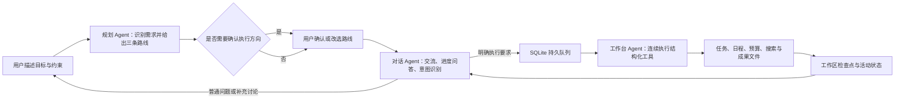
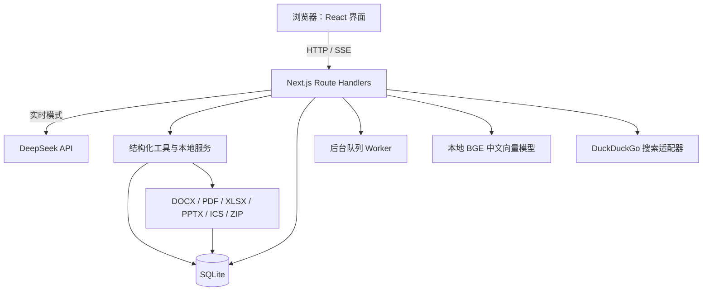

# VHFXNEX 技术说明书（工作稿）

> **版本状态：工作稿，不是最终参赛 PDF。** 作品架构和本地验收数据依据当前仓库整理；学校、团队成员、正式演示场景、部署地址、真实模型调用数据和最终截图尚未提供或确认，均不得当作最终事实提交。建议正式版控制在 30 页以内。

## 封面信息（提交前补齐）

| 项目               | 内容                                                 |
| ------------------ | ---------------------------------------------------- |
| 作品名称           | VHFXNEX：目标驱动的 AI 执行工作台                    |
| 参赛赛道           | 全国高校 AI Web 开发挑战赛（以报名平台最终选项为准） |
| 学校               | 待填写                                               |
| 团队名称           | 待填写                                               |
| 团队成员与学号     | 待填写，按报名信息核对                               |
| 指导教师           | 待确认是否需要填写                                   |
| 项目仓库与演示地址 | 待填写；当前未完成公网部署                           |
| 文档日期           | 2026-11-13（工作稿）                                 |

## 摘要

VHFXNEX 是一个面向日常事务、活动策划和软件项目推进的 AI Web 工作台。用户用自然语言描述目标，规划模块先给出三条有区别的执行路线并标明推荐项；用户确认关键方向后，对话模块继续回答问题、解释进度并判断是否需要交接；只有明确的实际工作要求才进入工作台执行。工作台通过结构化工具创建任务、时间线、预算和文件，并把每一步的结果保存到工作区，用户可以在执行期间继续交流、停止任务或切换工作区。

项目重点是把“提出目标”推进为“可检查的执行结果”。作品使用 Next.js、React、TypeScript、SQLite 和 DeepSeek API，提供演示模式与实时 AI 模式。知识库使用本地中文向量模型配合关键词检索；办公成果和代码项目可预览、编辑或下载。网页静态预览被限制在沙箱中，生成的代码不会由服务端执行。

当前工作稿不声称已经完成公网部署或真实评委演示。自动化检查已覆盖本地 API、浏览器交互、权限边界、产物下载和若干恢复场景；真实模型生成质量、实时联网搜索到最终产物的演示链路、多模态模型效果、评审账号和实际团队分工仍需补充验证。

## 1. 项目背景与目标

### 1.1 面向的问题

处理一个综合目标时，用户通常需要在多个工具间拆解任务、整理材料、安排时间、生成文件，再手动跟踪执行进度。普通聊天界面容易停留在建议或计划；固定表单又要求用户预先知道应该选择什么功能。VHFXNEX 采用目标优先的入口，让用户先说要完成什么，再由系统识别方向、提出少量关键路线并执行明确任务。

### 1.2 目标用户

- 需要策划校园活动、整理准备事项并生成日程或文档的学生和社团成员。
- 需要拆解课程、个人安排或小型项目并持续跟踪进展的个人用户。
- 希望快速生成可下载原型、文档或代码工程的开发者和学习者。

这些是产品面向人群的设计假设。最终报告应结合团队实际访谈或测试材料说明，不应写成已经完成用户研究。

### 1.3 当前设计目标

1. 用户从一个自然语言目标进入，不要求先选生活、活动或开发等功能类别。
2. 初次规划时展示推荐路线与备选路线，让用户对方向作一次关键确认。
3. 执行过程中保持普通对话能力；进度问题由对话 Agent 读取已保存状态后直接回答。
4. 对明确任务，工作台 Agent 连续调用工具并保存进度，避免用户逐项催促。
5. 输出真实可检查的任务、文件、日程和代码包；没有生成的成果不得显示为已交付。

## 2. 产品方案与核心流程



### 2.1 首次规划

用户提交目标、约束和可选附件。规划接口生成项目标题、摘要、限制、三条路线、结构化任务和必要时的关键澄清问题。路线选择是常规人工确认入口；可安全默认的小细节不逐项追问。界面默认使用深度思考；用户选择快速模式时，服务端发送对应模式参数。

### 2.2 对话与交接

工作区对话请求先由对话 Agent 处理。它可以回答“做到哪里了”等状态问题、讨论目标或接收修改意见。只有识别为明确执行要求时才调用结构化交接工具。服务器先在 SQLite 中持久化对话、指令和队列任务，再向浏览器确认交接，避免页面断开后回复与后台任务状态不一致。

### 2.3 后台执行与结果

工作台 Agent 从持久队列领取任务，按目标选择可用工具，分步保存结果并通过 SSE 发送进度。页面切换、刷新或暂时断线时，可从服务端读取执行状态和已保存工作区。任务完成后，聊天中显示生成成果入口，用户可以查看、编辑或下载。

## 3. 系统架构



规划、对话、工作台和代码复核是同一 DeepSeek 提供方下的不同职责和工具权限，不是多个独立基础模型之间的协作。演示模式采用本地规则与固定样例，不伪装成实时模型调用。

### 3.1 关键组件

| 层次     | 当前实现                                                                                         |
| -------- | ------------------------------------------------------------------------------------------------ |
| 前端     | Next.js App Router、React、TypeScript、自定义 CSS、Motion、Lucide、TanStack Query                |
| API      | Next.js Route Handlers；会话校验、输入验证、工具授权、SSE 和产物接口                             |
| 模型     | DeepSeek V4.1 Flash（API 模型 ID：`deepseek-flash`）；实时规划和多步工具调用需配置服务端 API Key |
| 后台任务 | SQLite 持久队列与 Node worker；带执行租约、恢复和取消状态                                        |
| 数据     | better-sqlite3 12.11.1 / SQLite 保存用户、工作区、对话、任务、知识资料、向量索引和用量信息       |
| 检索     | 本地 BGE 中文向量模型和中英关键词/TF-IDF；语义结果与关键词来源融合                               |
| 文件     | 服务端生成 Office、PDF、日历和 ZIP；HTML 静态预览使用沙箱策略                                    |
| 可观测性 | OpenTelemetry 服务端 trace；属性白名单排除提示词、用户身份、图片和 API Key                       |

### 3.2 持久化与后台恢复

工作区和交接队列保存在 SQLite。执行前获取数据库租约，工作期间更新检查点；取消或完成后释放状态。多个标签页不能通过旧快照覆盖仍在执行的工作区。`npm run dev` 与 `npm start` 会启动 worker。部署目标必须提供持久文件系统；当前没有确认公网主机，也没有评审环境。

## 4. Agent 职责与权限边界

| 角色         | 负责事项                                               | 不负责事项                                   |
| ------------ | ------------------------------------------------------ | -------------------------------------------- |
| 规划 Agent   | 识别目标、整理约束、推荐执行路线、生成项目阶段和任务   | 不代表用户作不可逆的外部操作                 |
| 对话 Agent   | 回答问题、汇报后台状态、讨论修改、判断是否形成执行要求 | 不在普通问答中启动工作台工具                 |
| 工作台 Agent | 根据路线持续调用受校验工具、保存工作进度和交付物       | 不执行服务端生成的任意代码                   |
| 代码复核职责 | 静态校验生成源码，并可请求模型检查阻塞问题             | 模型复核不是安全沙箱，也不能证明程序没有漏洞 |

角色共享同一工作区目标、所选路线和持久任务状态。明确交接时，完整用户指令和附件会写入队列；普通进度问答不会触发执行。需要用户确认的点限于路线方向、日期等可能造成重大后果且缺乏安全默认的选择。

## 5. AI 与工具实现

### 5.1 结构化工具调用

工作台工具输入使用 Zod schema 验证，并在服务端检查业务边界。工具包括创建与更新任务、生成项目时间线、安排日程、草拟文档、预算计算、知识库查询和联网搜索等。模型没有生成必要产物时，系统按当前执行状态有限修复；每次成功工具结果先保存，异常不会抹掉已完成步骤。

### 5.2 知识库检索

用户资料按段落拆分，最多选择 600 个知识块建立向量索引。中文 BGE 量化模型在本机生成 512 维向量并缓存于 SQLite。关键词检索支持中文字符二元组和拉丁词元；两路候选用加权倒数排名融合。语义向量只编码资料标题和正文，不在查询和资料两边重复拼接通用提示语，以免共同前缀抬高无关匹配分数。当前本地校准门槛为 0.56，索引内容哈希包含模型/格式版本；模型不可用时回退关键词检索。

本机实测中，改写后的活动场地需求和相关资料余弦相似度为 0.628，活动主题资料为 0.664，无关学生证资料为 0.495。72 项 API smoke 还通过实际 SQLite 与 `/api/plan` 演示请求检查了向量写入、旧格式向量重建、混合召回和来源片段保留。这是本地自动化样例，不替代真实参赛资料上的人工召回评估。

### 5.3 联网搜索

项目提供 DuckDuckGo 搜索适配器，执行 Agent 在实时模式下可以调用搜索工具并返回安全 HTTP(S) 来源。适配器曾通过只读网络检查返回 5 条网页结果；模型是否在具体目标中正确决定搜索、搜索来源是否流入实时 SSE 与最终成果，仍待实时场景复核。演示模式不声称获得实时网络事实。

### 5.4 文档、图片、语音和视频

- 文档抽取：DOCX、XLSX、PPTX、PDF、Markdown、CSV/TSV、文本与代码文件可作为请求上下文，文件大小和包内容有上限。
- 图片：支持 JPG、PNG、GIF 和 WebP；服务器检查内容签名。真实模型视觉质量尚未单独验收。
- 语音：浏览器 SpeechRecognition 先把音频转成可编辑文本；服务端接收文本，不直接保存录音。
- 视频：浏览器本地最多抽取 6 帧作为联系表，仅向模型发送画面帧，不上传音轨。WebM、MP4 和 MOV 的本地解码已自动化验收，真实模型视觉理解未验收。

### 5.5 成果生成与代码校验

系统可以生成 DOCX、中文 PDF、XLSX、PPTX、Markdown、ICS 和 ZIP 代码项目。代码项目在保存前做语法、JS/Vue/CSS/HTML 本地引用、源码及常见启动脚本所需 npm 依赖声明和 package manifest 静态检查；系统不会执行生成源码。网页预览禁用脚本、远程网络和外部跳转，交互运行需用户自行下载项目并在本地启动。Google Calendar 与 GitHub 直接授权当前未接入：日历可导出 ICS，代码可下载 ZIP。

### 5.6 用量归因与缓存费用解释

系统按目标和规划、对话、工作台、代码复核、连接诊断等来源记录模型输入/输出 Token，工作区和管理界面据此查看用量。DeepSeek 缓存命中率按供应商报告的缓存输入 Token 计算：`缓存命中输入 Token ÷ 已提供缓存统计的输入 Token`。多个请求汇总时先累加 Token 再相除，因此是 Token 加权比例，不是“命中请求数 ÷ 总请求数”。供应商没有提供缓存字段的请求不计入比率；系统不会把 SDK 填充的默认零值当成真实未命中。

DeepSeek 上下文缓存复用的是已保存的相同输入前缀，不是语义相似度，也不表示回答正确或请求成功。缓存命中只按命中 Token 的输入单价降低费用，输出 Token 仍按输出价计费。工作区展示的美元区间按当前公开价估算历史 Token：下限假设未测输入命中且处于非高峰，上限假设未测输入未命中且处于高峰；它不等于账户账单，不含汇率、历史价格变化、赠送额度及单独计费的 Search/Fetch 请求。平台账单才是实际支出依据。供应商也说明缓存尽力而为、不会保证全部命中。 [DeepSeek 缓存规则](https://api-docs.deepseek.com/guides/kv_cache/) · [模型与价格](https://api-docs.deepseek.com/quick_start/pricing/)

## 6. 数据安全与隐私

1. 登录使用签名 HTTP-only Cookie；密码经过预处理后以 bcrypt 保存，恢复码一次性使用。
2. 工作区、知识库和备份按用户隔离；协作权限分为所有者、编辑者与只读成员。
3. AI 请求按用户和来源限流；跨源写请求会被拒绝。
4. DeepSeek Key 只从项目 `.env.local` 服务端读取；静态浏览器包密钥扫描通过。`.env.local` 与 SQLite 数据目录被 Git 忽略并未跟踪。
5. 上传内容有 MIME、签名、大小和解压规模校验；附件仅在需要时作为本轮上下文或待执行交接暂存。
6. 静态 HTML 预览禁用脚本与网络请求；代码不会在服务器侧执行。
7. OpenTelemetry 仅允许操作类型、模型/工具名、用量、状态和计数等白名单属性，不写入提示词正文或 API Key。

仍需在最终提交前扫描 Git 暂存内容并检查公开仓库历史；当前暂存区为空，但这不等于完整远程历史已完成审计。

## 7. 前端交互与可访问性

桌面工作区采用左侧项目阶段画布、中间对话、右侧行动计划。主区域显示用户和 Agent 交流、流式状态、可操作的工具结果与文件入口；项目阶段画布表达用户工作的推进阶段，不展示内部模型推理路径。用户消息以右侧气泡呈现。行动计划可独立滚轮和键盘滚动；全局导航可以从边缘收起。手机布局压缩为单栏/抽屉交互。

Playwright UI smoke 覆盖 1366×768、1280×720、平板和 320px 手机视口，并对注册、路线选择、执行工作区、账户设置、分享邀请、日历导出和知识库等界面运行 axe-core 可访问性检查。已实现页面的自动化可访问性结果不能替代对最终演示浏览器的人工视觉检查。

## 8. 测试与验收

截至 2026-11-13，本地记录的检查结果如下：

| 检查                | 结果           | 边界                                                                   |
| ------------------- | -------------- | ---------------------------------------------------------------------- |
| ESLint              | 通过           | 静态代码规范检查                                                       |
| TypeScript          | 通过           | `npx tsc --noEmit`                                                     |
| Next.js 生产构建    | 通过           | Next.js 16.4.5 Turbopack                                               |
| API smoke           | 72 项通过      | 本地服务、隔离测试账号、权限、队列、产物与混合知识召回；未启用实时模型 |
| Playwright UI smoke | 144 项通过     | 生产构建服务、桌面与移动交互、可访问性、后台恢复与成果同步             |
| 知识向量 smoke      | 通过           | 缓存模型离线推理，禁用远程下载                                         |
| Worker smoke        | 通过           | Node ESM 启动后退出，没有领取真实任务                                  |
| 生产依赖安装        | 通过           | 隔离目录 `npm ci --omit=dev`；运行依赖可加载，Playwright/ESLint 未安装 |
| 浏览器密钥扫描      | 通过           | 构建后的静态浏览器资源未发现配置 API Key                               |
| OpenTelemetry smoke | 5 个 span 通过 | 父子层级与隐私属性过滤                                                 |

以上自动化验收没有触发 DeepSeek 实时模型请求。搜索模型全链路、代码复核、真实视觉理解、高推理实际响应和真实 API 用量仍未在此轮验收。自动检查通过代表代码覆盖的样例通过，不等于真实评委场景已冻结或所有生成内容都正确。

## 9. 安装、运行与数据备份

### 本地开发

1. 安装 Node.js 24 或更高版本。
2. 在项目目录运行 `npm ci`，按提交的锁文件安装依赖。
3. 复制 `.env.example` 为 `.env.local`，填写 `SESSION_SECRET`；如需实时 AI，再配置 `DEEPSEEK_API_KEY`。
4. 运行 `npm run dev`，浏览器打开 `http://localhost:3000`。
5. 首次注册账号会成为管理员；生产评审账号需使用独立邮箱和账号，不得使用团队私人账户。

### 存储要求

应用当前使用 `data/goalflow.sqlite`。生产环境必须保证 `data/` 位于持久磁盘，并设置数据库备份和恢复流程；无持久卷的容器重启可能丢失账号和作品数据。当前未完成公网部署，也未验证任何具体主机的持久化能力。

### 可复现检查

```powershell
npm run lint
npx tsc --noEmit
npm run build
npm run smoke
npm run smoke:ui
npm run smoke:knowledge
npm run smoke:worker
npm run check:client-secrets
npm run smoke:telemetry
```

实时 AI 检查需显式选择对应脚本并会消耗 API 额度；本说明书不把它们列入无成本命令。

## 10. 创新点与应用价值

### 已由当前代码支持的设计点

- **目标优先的 Agent 分工**：规划、对话、工作台各自负责路线、交流与执行，通过持久交接连接，而不是让单个聊天框兼任所有状态。
- **连续执行与可恢复**：工具结果写入工作区，页面切换和断线后仍能查看进度。
- **统一成果交付**：任务和计划可以继续推进，也可以生成多种办公文件与可下载代码项目。
- **用户掌握关键方向**：路线由用户选择；普通细节尽量使用清晰、可调整的默认值。
- **本地语义知识增强**：知识向量由本地模型生成，搭配关键词回退，减少对额外付费模型调用的依赖。

以上是产品与工程设计特点，不是竞赛获奖或用户效果结论。正式材料应增加真实场景前后对比、演示结果和评委可复现证据。

## 11. 当前限制与后续计划

| 限制                         | 影响                             | 后续处理                                                                    |
| ---------------------------- | -------------------------------- | --------------------------------------------------------------------------- |
| 无公网演示部署               | 评委无法远程体验                 | 确认主机、持久磁盘、域名、TLS 和独立评审账号后部署；Docker 镜像尚未实建验收 |
| 主演示场景未冻结             | 技术文档和视频材料会继续变化     | 团队确认真实且可脱敏的校园活动或其他任务                                    |
| 实时模型链路未复核           | 不足以证明真实模型输出质量       | 规划一个小额、可控用量的实时验收，保存输入、响应和实际账单证据              |
| 视觉/语音/代码模型复核未验收 | 自动化只覆盖本地解析或模拟路径   | 用脱敏素材和一至两次受控请求完成针对性演示                                  |
| Calendar/GitHub 直连未接入   | 无法直接写外部日历或推送仓库     | 当前以 ICS 和 ZIP 交付；是否接入另行决定                                    |
| 静态代码检查不是沙箱执行     | 不能据此保证生成项目安全或可运行 | 不在服务端执行；本地受控运行并记录验证环境                                  |
| 缺少量化用户评估             | 暂无真实用户效率提升数据         | 组织小样本任务测试，记录完成时间、人工修改和错误率                          |

## 12. 团队分工、原创性与 AI 辅助（提交前填写）

| 成员             | 实际承担工作     | 证据                       |
| ---------------- | ---------------- | -------------------------- |
| 成员 A（待填写） | 待按真实贡献填写 | Git 提交、设计稿或功能记录 |
| 成员 B（待填写） | 待按真实贡献填写 | Git 提交、测试或文档记录   |
| 成员 C（待填写） | 待按真实贡献填写 | Git 提交、测试或演示记录   |

Codex 和 DeepSeek 用作开发辅助与产品中的模型服务。最终团队需如实说明 AI 辅助范围、人工审查和原创实现；依赖及模型的许可证、引用格式和平台规则需在提交前按赛事要求复核。不得根据账号、提交数量或工具使用自动推断成员贡献。

## 附录 A：提交前事实核对清单

- [ ] 用报名系统核实赛事正式规则、提交截止、队伍人数和允许的 AI 辅助方式。
- [ ] 填入真实团队名称、学校、成员、学号、指导教师及实际分工。
- [ ] 冻结主演示场景，准备脱敏的原始材料和最终成果。
- [ ] 录制真实实时 AI 流程，保留模型与工具用量记录；区分演示模式和实时模式。
- [ ] 完成人工视觉检查、真实模型联网搜索/代码/多模态专项复核。
- [ ] 公网部署并验证 HTTPS、SQLite 持久化、备份恢复和独立评审账号。
- [ ] 扫描 Git 完整提交历史、工作区和暂存区，不提交 `.env.local`、数据库或私人资料。
- [ ] 导出 PDF，检查中文字体、页码、目录和图表，在不超过赛事页数限制的前提下做全页视觉复核。
