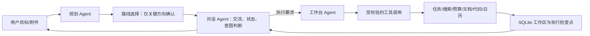

# VHFXNEX 技术文档提纲

目标：按赛事要求制作 PDF，控制在 30 页以内。建议最终 12–18 页，所有截图、测试数据和团队信息均用真实材料补齐。

当前已有一份完整的事实标注工作稿：[VHFXNEX 技术说明书工作稿](../deliverables/VHFXNEX-technical-report-draft.md)。它不是可直接提交的 PDF；真实团队资料、最终演示证据、部署信息和视觉复核仍需补齐。

## 建议目录

1. **封面与摘要**：作品名、团队/学校信息、作品一句话说明。
2. **问题与目标用户**：选定的主场景、现有流程痛点、成功标准。
3. **产品方案**：用户从目标输入到路线确认、持续执行、成果交付的完整流程。
4. **系统架构**：Next.js Web、API 路由、SQLite/持久队列 worker、DeepSeek、SSE、文件产物。
5. **Agent 分工与协作**：规划 Agent、对话 Agent、工作台 Agent 的职责、上下文边界、交接格式、何时请求人工确认。
6. **AI 技术方案**：模型选择理由、Function Calling、多步执行、向量语义检索与关键词降级、联网搜索、图片/文档/视频帧上下文、静态代码校验和复核成本、失败修复与限制。
7. **数据与安全**：登录会话、密码/恢复码、工作区所有者/编辑者/只读权限、限流、Key 管理、附件处理、隐私遥测。
8. **前端与交互设计**：主聊天、路线选项、执行进度、行动计划、项目流程、响应式和无障碍。
9. **核心工具和交付物**：任务、时间线、预算、搜索、Office/PDF/ICS/代码 ZIP 的输入输出示例。
10. **测试与评估**：测试矩阵、通过率、边界/失败恢复结果、真实场景验收及已知限制。
11. **部署与复现**：Node 版本、安装步骤、`.env.example`、数据库持久化、评审账号、运行/备份说明。
12. **创新点、应用价值与展望**：只写能由系统和演示证据证明的内容。
13. **团队分工与原创性说明**：真实贡献、AI 辅助开发的使用方式、开源依赖与许可证。

## 推荐系统图

注：规划、对话、工作台与代码复核角色使用同一 DeepSeek 服务的不同职责与工具范围；不要误述为独立模型集群。知识库语义召回由本地缓存的量化中文 BGE 模型生成向量，并以 SQLite 保存；模型不可用时回退到词元/TF-IDF 排序。语音使用浏览器 SpeechRecognition，视频只在客户端抽取画面帧，不处理或上传音轨。代码静态校验不等同于在沙箱中运行代码，独立模型复核会增加 DeepSeek 用量。

## 完稿前必须填实的数字

- 测试样例总数、通过数、失败修复结果。
- 真实任务从输入到交付的耗时、工具调用数、产物数量。
- 实时模型产生的真实用量；演示模式数据需明确标记。
- 评审使用的部署地址和测试账号有效期。
- 团队成员的实际开发分工。
